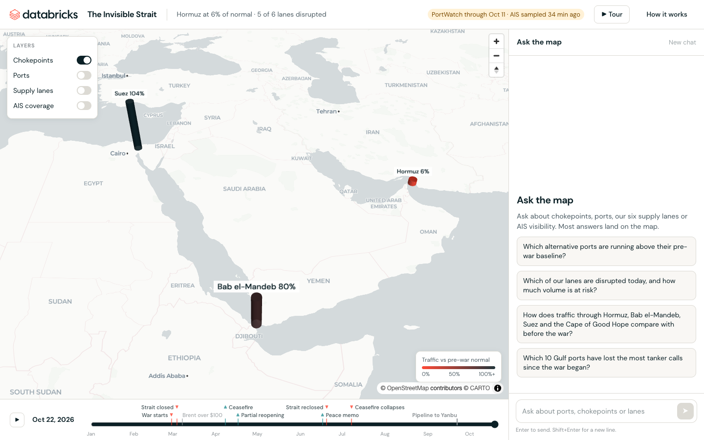
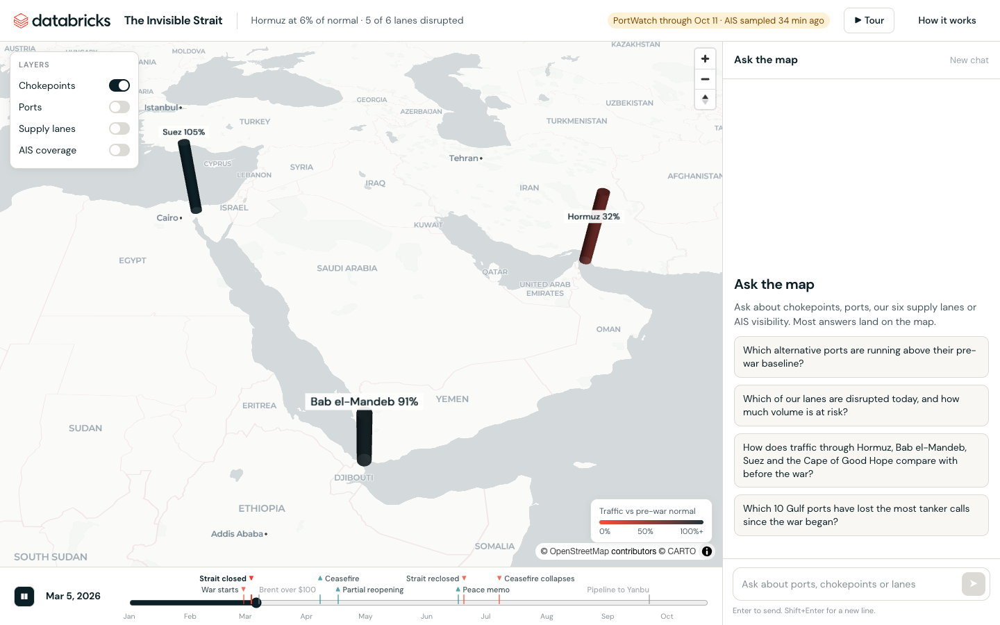
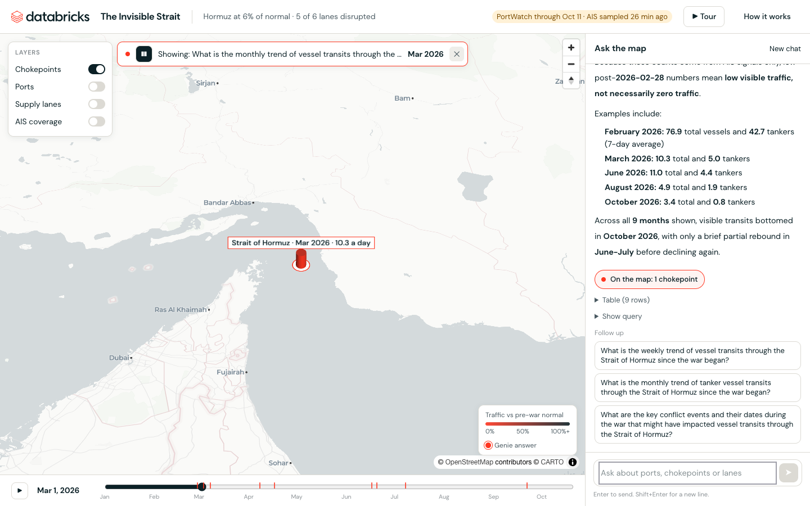
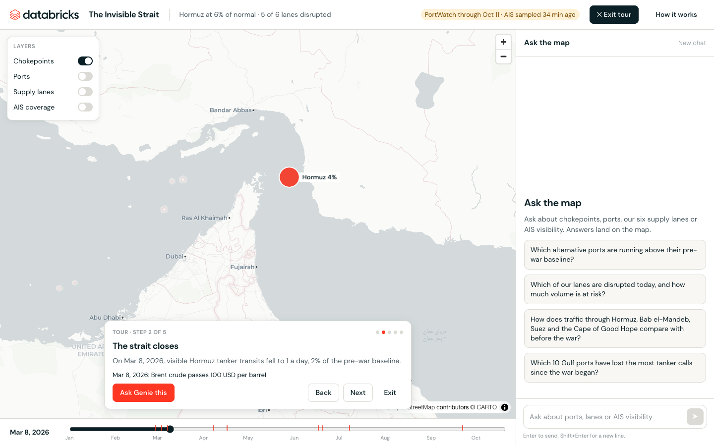
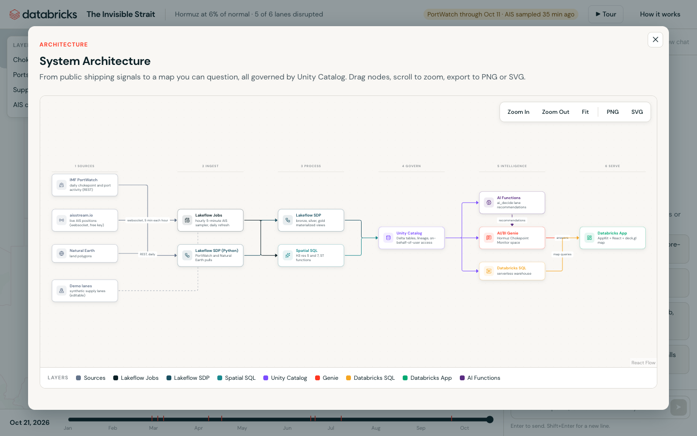

# The Invisible Strait

AIS-visible ship transits through the Strait of Hormuz fell from about 78 a day in February 2026 to about 3 a day in September, while regional oil exports reportedly recovered. This repo is a plug-and-play Databricks demo that measures the gap: free public data, one Declarative Automation Bundle, and a Genie space to ask questions in plain English. It does not measure traffic. It measures what AIS can see, and how that changes over time and against busy control lanes.

Average daily transits through the Strait of Hormuz, 2026 (IMF PortWatch, AIS-visible vessels only):

| Jan | Feb | Mar | Sep |
|---|---|---|---|
| 58.5 | 78.3 | 3.2 | 3.6 |

## Sources

Exactly three, all free. Only aisstream.io needs a key.

| Source | Key | Use |
|---|---|---|
| IMF PortWatch (ArcGIS REST) | none | Daily chokepoint transits, daily port calls and trade |
| aisstream.io (websocket) | free | Live AIS samples, used to measure visibility |
| Natural Earth `ne_50m_land.geojson` | none | Land polygons |

## Prerequisites

- Databricks CLI 0.292 or later, authenticated (`databricks auth login --profile <p>`)
- Serverless compute enabled, with outbound internet access
- A SQL warehouse (for the app and Genie)
- `uv` for the helper script and tests
- Node.js and npm only for local app development (the Apps container builds the app itself)
- Optional: a free aisstream.io key for the [AIS visibility sampler](#ais-visibility-sampler)
- Optional: `ai_decide` (Beta) enabled in the workspace for the [decision layer](#decision-layer-optional)

## Quickstart

Genie is optional, and the Genie space is built over tables that only exist after the first deploy and reference run, so a fresh install runs in two phases. Phase 1 deploys with the placeholder `genie_space_id=none`, which leaves Genie off; phase 2 redeploys with the real space id.

**Phase 1: deploy, load the data, build the Genie space**

```bash
# 1. Create the schema
databricks schemas create hormuz <catalog> --profile <p>

# 2. Deploy the bundle with the Genie placeholder
databricks bundle deploy --var="catalog=<catalog>" --var="schedule_pause_status=UNPAUSED" --var="warehouse_id=<warehouse-id>" --var="genie_space_id=none" --profile <p>

# 3. Load the reference data (about 30 minutes)
databricks bundle run hormuz_reference --var="catalog=<catalog>" --var="schedule_pause_status=UNPAUSED" --var="warehouse_id=<warehouse-id>" --var="genie_space_id=none" --profile <p>

# 4. Optional: the AIS sampler (needs the aisstream key, see below), then the decision layer
#    (needs ai_decide, and reads gold_ais_visibility_index, so run the sampler at least once first)
databricks bundle run hormuz_ais_sampler --var="catalog=<catalog>" --var="schedule_pause_status=UNPAUSED" --var="warehouse_id=<warehouse-id>" --var="genie_space_id=none" --profile <p>
databricks bundle run hormuz_decisions --var="catalog=<catalog>" --var="schedule_pause_status=UNPAUSED" --var="warehouse_id=<warehouse-id>" --var="genie_space_id=none" --profile <p>

# 5. Build the Genie space; it prints space_id=<genie-space-id>
uv run --no-project python -m genie.build_space \
  --profile <p> --catalog <catalog> --schema hormuz --warehouse-id <warehouse-id>
```

`genie.build_space` leaves out any table that does not exist yet (for example `gold_lane_recommendation` without ai_decide, or the AIS tables without a key), along with the examples and instructions that use it. Rerun it after those tables exist to add them; it updates the same space (the id is kept in the git-ignored `genie/.space_id`).

**Phase 2: redeploy with the space id and start the app**

```bash
# 6. Redeploy with the real Genie space id
databricks bundle deploy --var="catalog=<catalog>" --var="schedule_pause_status=UNPAUSED" --var="warehouse_id=<warehouse-id>" --var="genie_space_id=<genie-space-id>" --profile <p>

# 7. Build and start the app; prints the app URL
databricks bundle run hormuz_map --var="catalog=<catalog>" --var="schedule_pause_status=UNPAUSED" --var="warehouse_id=<warehouse-id>" --var="genie_space_id=<genie-space-id>" --profile <p>
```

You can also run step 7 in phase 1. The app then starts with Genie off: the chat says "Genie is not configured for this app" and the question box is disabled. A table that does not exist yet shows a banner naming the query and table, and the rest of the map still renders.

`catalog` and `warehouse_id` are required and have no default. Pass all four variables on every bundle command, quoted as shown, or export `BUNDLE_VAR_catalog`, `BUNDLE_VAR_schedule_pause_status`, `BUNDLE_VAR_warehouse_id` and `BUNDLE_VAR_genie_space_id` once as a shortcut. In the rest of this README, `<genie-space-id>` means `none` until you have built the space.

Every reference refresh, not only the first, re-fetches PortWatch in full (chokepoints since 2019, ports since 2024, in yearly and per-country slices) and takes about 30 minutes. A selective `--refresh` of named downstream tables (see [App](#app)) skips the fetch. The `hormuz_reference_daily` job (07:00 UTC) has a 1 hour timeout and one retry.

**Schedules are opt-in.** Without `schedule_pause_status`, all three jobs (`hormuz_reference_daily`, `hormuz_ais_sampler` and `hormuz_decisions_weekly`) deploy with their schedules paused. The commands in this README pass `schedule_pause_status=UNPAUSED`, which enables them. Redeploying with `--var="schedule_pause_status=PAUSED"` pauses the schedules again.

Bundle variables (`--var="name=value"`):

| Variable | Default | Meaning |
|---|---|---|
| `catalog` | none (required) | Unity Catalog catalog |
| `schema` | `hormuz` | Schema (create it first) |
| `schedule_pause_status` | `PAUSED` | `PAUSED` or `UNPAUSED` for all three job schedules |
| `bbox` | `12,32,31,62` | lat_min,lon_min,lat_max,lon_max; only clips `ref_land_region` (AIS sampling regions are defined in `src/hormuz_sources/regions.py`) |
| `secret_scope` | `hormuz` | Secret scope holding the aisstream key |
| `warehouse_id` | none (required) | SQL warehouse for the app |
| `genie_space_id` | `none` | Genie space id printed by `genie/build_space.py`; the placeholder `none` leaves Genie off |

## AIS visibility sampler

1. Sign up at [aisstream.io](https://aisstream.io) (GitHub login, free) and copy your API key.
2. Store it:
   ```bash
   databricks secrets create-scope hormuz --profile <p>
   databricks secrets put-secret hormuz aisstream_api_key --string-value "$(pbpaste)" --profile <p>
   ```
   `pbpaste` reads the macOS clipboard. In a terminal, `put-secret` without `--string-value` can also prompt for the value.
3. Run it: `databricks bundle run hormuz_ais_sampler --var="catalog=<catalog>" --var="schedule_pause_status=UNPAUSED" --var="warehouse_id=<warehouse-id>" --var="genie_space_id=<genie-space-id>" --profile <p>`

The job listens for 5 minutes, appends raw rows, then refreshes the `hormuz_ais` pipeline. When enabled (see above) it runs hourly at :05 UTC (job timeout 45 min; sample task 10 min, pipeline refresh 30 min). The job fails loudly if aisstream returns no messages together with an error, for example a bad key.

**Why a visibility index.** A live probe on 2026-10-08 returned 877 aisstream messages in 20 seconds for the North Sea, but about 3 in 105 seconds across the Gulf and Red Sea together. A continuous stream would sit idle, so the near-silence itself became the measurement. Regions:

| Role | Regions |
|---|---|
| Targets | `gulf_hormuz`, `red_sea` |
| Controls | `north_sea_channel`, `suez_east_med`, `malacca_singapore` |

`gold_ais_visibility_index.visibility_vs_control` is the target lane's vessel density divided by the median control lane density, with per-control ratio columns alongside. In the first two hourly samples (2026-10-08) the Gulf heard 4 to 8 unique vessels, about 1 to 2 percent of the median control lane; the Red Sea heard 0; the North Sea heard 6,525 vessels in one 5-minute window. Two samples are a thin series; let it run for a few days before drawing conclusions.

**Cost.** Each run uses about 5 minutes of serverless compute plus a short pipeline refresh, every hour. The schedule is paused by default; redeploy without `schedule_pause_status=UNPAUSED` to pause it again.

## Decision layer (optional)

The `hormuz_decisions` pipeline builds `gold_lane_recommendation`: an `ai_decide` recommendation per demo lane on weekly snapshot dates (every Monday from 2026-02-02, plus the latest data date). SQL turns each lane's numbers into a plain-language description, `ai_decide` only classifies it (situation, action, shift target, signal quality, with calibrated probabilities), and SQL composes the tier. Genie answers recommendation questions from `gold_lane_recommendation`.

- **Prerequisite:** `ai_decide` is in Beta and must be enabled in your workspace. It also reads `gold_ais_visibility_index`, so run the [AIS sampler](#ais-visibility-sampler) at least once first.
- **Optional by design:** it runs in its own pipeline and its own `hormuz_decisions_weekly` job (Mondays 08:00 UTC, paused unless `schedule_pause_status=UNPAUSED`). Without ai_decide only that pipeline and job fail; the app treats the missing table as "feature off", with no error banner, and `genie.build_space` leaves the table out of the space.
- **Cost:** about 220 `ai_decide` calls per run (about 37 snapshot dates times 6 lanes, six more each week), billed at Databricks SQL rates.

Run it by hand:

```bash
databricks bundle run hormuz_decisions --var="catalog=<catalog>" --var="schedule_pause_status=UNPAUSED" --var="warehouse_id=<warehouse-id>" --var="genie_space_id=<genie-space-id>" --profile <p>
```

**Thresholds (untuned demo values).** The tier is the first rule that applies:

| Tier | Rule |
|---|---|
| Novel situation | `action` is `none_fit`, or the top action probability is below 0.40 |
| Analyst | `signal_quality` score is 1.5 or more (mixed or thin signals) |
| Recommended | `action` confidence is 0.90 or more |
| Review | `action` confidence is 0.60 or more |
| Analyst | otherwise |

These are starting points, not tuned values; the Genie space is told to call them "untuned demo thresholds". The lane status that feeds the description (`gold_lane_status`) also uses demo thresholds: Normal when the primary port is at 80 percent of its pre-war baseline or more, Degraded from 50 to 80, Shifted to alternative below 50 when the alternatives are at 100 percent or more, otherwise Disrupted.

## App

`hormuz-map` is an AppKit (React and TypeScript) Databricks App in `app/`, deployed by the same bundle (`resources/hormuz_app.app.yml`). It is one screen: a map and a chat with Genie.

- **3D columns:** chokepoints and ports stand as columns whose height is vessels a day (7-day average), colored by percent of pre-war normal. The map is tilted to 45 degrees; right-drag (or drag the compass) to rotate it or change the tilt, and click the compass to reset.
- **Ask the map:** ask a question in plain English. Genie answers in the chat, and the places, H3 cells or lanes in the answer are drawn on the map in Lava; the rest of the map dims and its labels hide. Click an older reply's map chip to show its answer again, or close the "Showing" pill to clear it. Hovering a table row highlights its mark.
- **Trend answers:** a Genie answer about places over time (for example "What is the monthly trend of vessel transits through the Strait of Hormuz since the war began?") plays as Lava columns, one frame per period, with play and pause in the "Showing" pill; the date slider follows the frame. Clearing the answer puts the slider back on the date you had before it.
- **Layers:** chokepoints (on at rest), ports, supply lanes and AIS coverage, each toggled on its own. The date slider along the bottom moves every layer through 2026, with the war events marked; its play button animates the year a day at a time (a week at a time with reduced motion), and dragging the slider pauses it.
- **Tour:** five short steps (your exposure, the strait closes, where traffic went, lanes with no way around, what you cannot see), on the same tilted map. Each step has an "Ask Genie this" button. Exiting returns the map to where it was.
- **How it works:** the architecture diagram.

A freshness badge in the top bar shows the latest PortWatch day and the age of the last AIS sample, and turns amber when PortWatch is more than 7 days old or the last AIS sample more than 3 hours old.

Data bounds in the app:

- **AIS: last 30 days.** The AIS cell and visibility queries read only the last 30 days, to stay under AppKit's 5 MB limit per result as hourly samples accumulate. On a date more than 30 days back, the map shows no AIS cells and the AIS coverage labels read "no data". The tables themselves keep the full history.
- **Ports: through 2026-12-31.** Port data is loaded in three fixed 2026 date chunks (`app/config/queries/ports_daily*.obo.sql`), so ports stop at the end of 2026 while chokepoints, lanes and AIS keep growing. To extend into 2027, add a `ports_daily_4` chunk and a matching slot in `app/client/src/data/loadAll.ts`.

The supply lanes belong to a fictional company (Northwind Supply Co.) and are synthetic. Edit them in `src/pipelines/reference/ref_demo_lanes.sql`, deploy, and refresh only the lane tables (never a full refresh of `hormuz_reference`, which re-fetches PortWatch):

```bash
databricks bundle run hormuz_reference --refresh ref_demo_lanes,gold_lane_status --var="catalog=<catalog>" --var="schedule_pause_status=UNPAUSED" --var="warehouse_id=<warehouse-id>" --var="genie_space_id=<genie-space-id>" --profile <p>
# Optional, if you use the decision layer:
databricks bundle run hormuz_decisions --var="catalog=<catalog>" --var="schedule_pause_status=UNPAUSED" --var="warehouse_id=<warehouse-id>" --var="genie_space_id=<genie-space-id>" --profile <p>
```

An alternative port name that does not match a PortWatch port shows up as a warning on the `alt_ports_resolved` expectation in the `hormuz_reference` event log.







### Deploy

The [Quickstart](#quickstart) covers a first install. To redeploy after a change:

```bash
cd app && npm install && npm run typegen && databricks apps validate --profile <p> && cd ..
databricks bundle validate --var="catalog=<catalog>" --var="schedule_pause_status=UNPAUSED" --var="warehouse_id=<warehouse-id>" --var="genie_space_id=<genie-space-id>" --profile <p>
databricks bundle plan --var="catalog=<catalog>" --var="schedule_pause_status=UNPAUSED" --var="warehouse_id=<warehouse-id>" --var="genie_space_id=<genie-space-id>" --profile <p>
databricks bundle deploy --var="catalog=<catalog>" --var="schedule_pause_status=UNPAUSED" --var="warehouse_id=<warehouse-id>" --var="genie_space_id=<genie-space-id>" --profile <p>
databricks bundle run hormuz_map --var="catalog=<catalog>" --var="schedule_pause_status=UNPAUSED" --var="warehouse_id=<warehouse-id>" --var="genie_space_id=<genie-space-id>" --profile <p>
databricks apps get hormuz-map --profile <p>
```

Drop `schedule_pause_status=UNPAUSED` if you want the job schedules paused. `bundle run hormuz_map` prints the app URL (`https://hormuz-map-<id>.<cloud>.databricksapps.com`). The Apps container installs from the committed `app/package-lock.json` and runs `npm run build`; `node_modules` and `dist` are excluded from the bundle sync. Run `npm run typegen` locally before a deploy: the container build tolerates a typegen failure (see below), so a genuine SQL error in `app/config/queries` would otherwise only show up at runtime.

### Permissions

The app queries data and calls Genie **as the viewer** (on behalf of the user, scopes `sql` and `dashboards.genie`). Each viewer needs:

- `USE CATALOG` on the catalog, and `USE SCHEMA` and `SELECT` on `<catalog>.hormuz`;
- `CAN_USE` on the SQL warehouse;
- `CAN_RUN` on the Genie space (only when Genie is configured).

The first visit shows a consent screen for those scopes. The bundle grants the app service principal `CAN_USE` on the warehouse; it needs no Genie grant and no data grants.

**Build-time types.** The container build runs AppKit type generation as the app service principal. That step is non-fatal: when a table does not exist yet, or the principal cannot read it, the build logs `AppKit typegen WARNING` and builds with the committed types in `app/shared/appkit-types`. Runtime queries are unaffected. Optional, to refresh real types in the container, grant the principal read access once (its client id is `service_principal_client_id` in `databricks apps get hormuz-map`):

```sql
GRANT USE CATALOG ON CATALOG <catalog> TO `<app-sp-client-id>`;
GRANT USE SCHEMA, SELECT ON SCHEMA <catalog>.hormuz TO `<app-sp-client-id>`;
```

### Local development

```bash
cd app
cp .env.example .env   # set DATABRICKS_CONFIG_PROFILE or DATABRICKS_HOST, DATABRICKS_WAREHOUSE_ID and (optional) DATABRICKS_GENIE_SPACE_ID
npm install
npm run dev            # http://localhost:8000
npm test
```

`.env` is git-ignored. Optional overrides: `HORMUZ_CATALOG` (default `jdub_demo`), `HORMUZ_SCHEMA` (default `hormuz`) and `GENIE_SPACE_TITLE`. Locally, queries run as your CLI identity. Leave `DATABRICKS_GENIE_SPACE_ID` unset (or `none`) to run without Genie.

## Tables

Schema `<catalog>.hormuz`.

**Reference pipeline (`hormuz_reference`)**

| Table | Description |
|---|---|
| `bronze_portwatch_chokepoints_daily` | Raw daily chokepoint transits from PortWatch |
| `bronze_portwatch_ports_daily` | Raw daily port calls and trade from PortWatch |
| `ref_portwatch_chokepoints` | Chokepoint locations and metadata |
| `ref_portwatch_ports` | Port locations and metadata (Yanbu appears as `Yanbu (Yanbu city)` and `Yanbu (King Fahd Port)`) |
| `ref_land_region` | Land polygons clipped to the bbox |
| `ref_conflict_events` | Curated conflict event dates for annotation |
| `gold_chokepoint_daily` | Chokepoint transits against the pre-war baseline |
| `gold_port_daily` | Port activity, including bypass-port changes |
| `ref_demo_lanes` | Synthetic supply lanes for a fictional company (Northwind Supply Co.); every value is an editable demo assumption |
| `gold_lane_status` | Daily status per demo lane (Normal, Degraded, Shifted to alternative, Disrupted, No data) and assumed volume at risk |

**AIS pipeline (`hormuz_ais`)**

| Table | Description |
|---|---|
| `bronze_ais_samples` | Raw messages written by the sampler job (not by the pipeline); the last row of each sample is a `_heartbeat` describing the window |
| `ref_ais_regions` | Target and control region definitions |
| `silver_ais_positions` | Parsed position reports per region |
| `gold_ais_visibility` | Per-sample, per-region counts, including `sample_ok` and `vessel_density` |
| `gold_ais_visibility_index` | `visibility_vs_control` and per-control ratios |
| `gold_ais_h3_daily` | Daily H3 cell aggregates; `unique_vessels` is per cell, so do not sum it across cells |

**Decision pipeline (`hormuz_decisions`, optional)**

| Table | Description |
|---|---|
| `gold_lane_recommendation` | Weekly `ai_decide` recommendation per demo lane: action, probabilities, confidence, shift target, situation, signal quality and tier (see [Decision layer](#decision-layer-optional)) |

## Caveats

- PortWatch counts only AIS-visible vessels. A drop means fewer ships broadcasting and received, not necessarily fewer ships.
- aisstream relies on community shore receivers and does not replay history. Coverage differs by region, and a quiet window cannot be recovered later.
- Check the terms of aisstream.io and IMF PortWatch for your use, especially before republishing data.
- Conflict event dates come from public reporting. Verify them against primary sources before citing.

## Cleanup

```bash
databricks bundle destroy --var="catalog=<catalog>" --var="schedule_pause_status=UNPAUSED" --var="warehouse_id=<warehouse-id>" --var="genie_space_id=<genie-space-id>" --profile <p>
databricks experimental aitools tools query "DROP SCHEMA <catalog>.hormuz CASCADE" --profile <p>   # or run it in a SQL editor
databricks secrets delete-scope hormuz --profile <p>
```

Delete the Genie space from the Genie UI if you created one.

## Tests

```bash
uv run --no-project --with pytest --with websockets --with requests pytest -q
```
